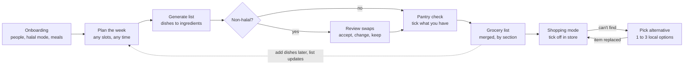

# Weekly Meal-to-Grocery App — PRD

Working name: **MenuCart** · Exported Oct 9, 2026 · Source of truth: the Claude Doc "Weekly Meal-to-Grocery App — PRD"

## Overview & problem

The app turns a home cook's weekly menu (up to 21 dishes: breakfast, lunch and dinner, Monday to Sunday) into one consolidated, halal-safe grocery list.

Home cooks who plan a week of meals hit three problems:

1. **Ingredient overload.** Twenty-one dishes can mean 80+ ingredient lines, with overlaps (garlic in 9 dishes) that are tedious to add up by hand.
2. **Unknown or unavailable ingredients.** The cook doesn't always know what a dish needs, and some items (pancetta, mascarpone, fresh thyme) are hard to find at the local market.
3. **Halal conflicts.** Many Western dishes depend on pork or alcohol. Carbonara uses guanciale; beef bourguignon uses red wine. The cook wants the dish, not the haram ingredient.

MenuCart solves this by letting the cook type dish names, generating the ingredients for each, flagging non-halal items with a ready swap, merging everything into a list grouped by market section, and letting the cook tick off what they already have.

## Target user & personas

The primary user is a Muslim home cook who plans a week ahead and shops once or twice a week at a supermarket or traditional market.

| Persona | Context | Main need |
| --- | --- | --- |
| **Rina, 34, working parent** | Cooks dinner daily, lunch on weekends. Plans on Sunday night. | One list she can shop from in 40 minutes, no backtracking between aisles. |
| **Fajar, 27, adventurous cook** | Tries 2 to 3 Western recipes a week from YouTube. | Halal versions of dishes like carbonara or coq au vin that still taste right. |
| **Ibu Sari, 52, family cook** | Cooks Indonesian staples for 5 people, buys at the pasar. | Correct quantities for her household and local names for ingredients. |

## Goals, non-goals & success metrics

**Goals**

- Turn a partial or full weekly menu into a merged grocery list in under 2 minutes.
- Flag every non-halal ingredient and offer at least one halal swap for it.
- Let the cook remove what they already have so the list shows only what to buy.
- Help the cook when an ingredient is unavailable, with a common local alternative.

**Non-goals (v1)**

- Full step-by-step recipes and cooking instructions.
- Online ordering or delivery integration.
- Halal certification of specific brands or products.
- Nutrition and calorie tracking.

**Success metrics**

| Metric | Target at 3 months |
| --- | --- |
| Weekly plans that reach a generated list | 70% |
| Time from first dish entered to list generated | under 2 min median |
| Halal swaps accepted (vs dismissed) | 60% |
| Users returning to plan a second week | 45% |
| List items ticked off during a shopping trip | 80% |

## User stories

| ID | As a home cook, I want to… | So that… | Priority |
| --- | --- | --- | --- |
| US-01 | add a dish to any breakfast, lunch or dinner slot, Monday to Sunday | I can plan the week my way | Must |
| US-02 | leave slots empty and come back later | I'm not forced to plan everything at once | Must |
| US-03 | see the ingredients the app found for each dish and edit them | the list matches how I actually cook it | Must |
| US-04 | be told when a dish has non-halal ingredients, with a swap | I can still cook carbonara the halal way | Must |
| US-05 | get one merged list with quantities added up | I don't buy garlic three times | Must |
| US-06 | tick off what I already have at home | the list shows only what I need to buy | Must |
| US-07 | see the list grouped by market section | I move through the store once | Should |
| US-08 | mark an item "can't find" and get an alternative | I'm not stuck in the aisle | Should |
| US-09 | set how many people I'm cooking for | quantities fit my household | Should |
| US-10 | reuse a past week or a favourite dish | planning gets faster each week | Could |

## Core user flow

Only dishes with a non-halal ingredient detour through swap review. The planner stays open the whole week: new dishes update the list without resetting ticks.

## Functional requirements

**F1. Weekly menu planner**

- A 7-day by 3-slot grid (Breakfast, Lunch, Dinner), 21 slots total. Breakfast is on by default; users who skip it turn it off in onboarding or Settings, and the count drops to 14. Breakfast often repeats, so its slot offers "Repeat all week" and quick picks (bubur ayam, roti bakar, nasi uduk, oatmeal). Week starts Monday.
- Tap a slot to add a dish by typing a name; show autocomplete from a dish library and recent dishes.
- Each slot holds one dish in v1. A slot can be edited, cleared or moved to another slot.
- Progress indicator: "6 of 21 meals planned". No minimum; the list can be generated from 1 dish.
- Plans auto-save as a draft. The user can leave and return anytime during the week.

**F2. Ingredient digest**

- On "Generate list", the app resolves each dish into ingredients with quantity and unit, scaled to household size (default 2, range 1 to 10).
- Each dish has a detail sheet listing its ingredients; the user can add, remove or edit lines.
- Dishes the app cannot recognise show an "Add ingredients manually" prompt instead of failing silently.

**F3. Halal check & swaps**

- Every ingredient is tagged Halal, Non-halal, or Check (depends on source or brand, e.g. gelatin, cheese rennet).
- Dishes with any Non-halal ingredient get a badge in the planner and a swap card on the review screen.
- The user can accept the suggested swap, pick another option, or keep the original. Accepted swaps update the dish and the list.
- A global setting "Always apply halal swaps" auto-accepts the top suggestion.

**F4. Merged grocery list**

- Duplicate ingredients across dishes merge into one line with summed quantity (2 cloves + 4 cloves = 6 cloves garlic).
- Units convert where safe (g and kg); incompatible units stay as separate sub-lines.
- Grouped by section: Produce, Meat & Poultry, Seafood, Dairy & Eggs, Dry Goods & Spices, Others.
- Each line shows which dishes use it (tap to expand).

**F5. Pantry check**

- Before shopping, a "What do you already have?" step lets the user tick items they own. Ticked items move to an "At home" section, not deleted.
- Pantry staples (salt, cooking oil, sugar) are pre-marked "probably at home" and can be toggled.

**F6. Shopping mode & can't-find**

- Large checkbox list for use in the store; ticked items collapse to the bottom.
- Each item has a "Can't find" action that shows 1 to 3 alternatives with a short note on taste impact. Picking one replaces the line.
- The list can be shared as plain text to WhatsApp.

## Halal substitution logic

Swaps are ranked by how close they keep the dish's flavour role (fat, smoke, salt, acidity, depth), not just by ingredient category. Each swap card says what the original did and what the swap does.

| Non-halal ingredient | Role in the dish | Suggested swaps (ranked) | Example dish |
| --- | --- | --- | --- |
| Guanciale / pancetta | Salty, rendered fat | Smoked beef (beef bacon), beef brisket fat, smoked turkey | Carbonara |
| Bacon | Smoke, crunch, salt | Beef bacon, smoked chicken, smoked paprika + mushrooms | Club sandwich |
| Ham | Cured, salty slice | Smoked turkey breast, chicken ham (halal-certified) | Croque monsieur |
| Pork mince | Fatty mince | Beef mince (15–20% fat), chicken thigh mince | Lasagna, dumplings |
| Lard | Cooking fat | Beef tallow, ghee, butter | Pastry, tamales |
| Red / white wine | Acidity, depth | Grape juice + 1 tbsp vinegar, stock + lemon | Bourguignon, risotto |
| Mirin | Sweet acidity | Rice vinegar + sugar | Teriyaki |
| Beer | Bitterness, lift in batter | Sparkling water, non-alcoholic malt drink | Fish & chips |
| Vanilla extract | Aroma (alcohol base) | Vanilla powder, vanilla bean, alcohol-free extract | Cakes |
| Gelatin (unspecified) | Setting agent | Agar-agar, halal beef gelatin | Panna cotta |

**Rules**

- "Check" items (cheese, gelatin, stock cubes, sauces) get a soft note: "Look for a halal logo." They are not auto-swapped.
- Swaps are suggestions, not religious rulings. The app shows a one-time note explaining this.
- The ingredient database is reviewed by a culinary lead; halal tags are reviewed against a recognised halal authority's guidance before launch.

## Edge cases, empty states & errors

The app is **local-first**: every plan, list and tick is saved on the phone first and synced when a connection is available. Only three things truly need the network: signing in, generating ingredients for a new dish, and syncing between devices.

**Connectivity & data**

| Situation | Behaviour |
| --- | --- |
| No internet while planning | Dishes save locally. A slim banner says "Offline. Changes saved on this phone." |
| Generate list tapped while offline | Dishes already in the local dish library resolve instantly. Unknown dishes are queued: "3 dishes will get ingredients when you're back online." The list shows what it can now. |
| Connection drops mid-generate | Keep the dishes already resolved; retry the rest automatically. Never show a half-merged list without a note. |
| Data quota running out / slow 2G | "Data saver" mode: no images, text-only sync, generation batched into one request per week, not per dish. |
| Back online after offline edits | Sync silently in the background. Show "Synced" once, never a modal. |
| Same plan edited on two devices | Last edit per slot wins; ticks merge (a tick on either device counts). If a slot conflicts, keep both and ask once. |
| Shopping in a store with no signal | Shopping mode is fully offline, including can't-find alternatives for items already on the list (pre-fetched at list creation). |
| App killed or phone restarts mid-shop | Reopen exactly where they were: same list, same ticks, same scroll position. |

**Sign in & session**

| Situation | Behaviour |
| --- | --- |
| Session expires while offline | Never lock the user out of their own data. Keep plan and list readable and editable; ask to sign in again only when they're back online and something needs to sync. |
| Magic link expired or already used | Clear screen: "This link has expired" + one button to send a new one. |
| Link opened on a different device (laptop vs phone) | Sign in on the device that opened it; tell the original device "Signed in on another device" with a resend option. |
| Email takes long or lands in spam | After 30 s show "Check spam or Promotions" and a resend button with a 60 s cooldown. |
| Typo in email address | "Check your inbox" screen shows the address in full with "Wrong email? Change it." |
| Email app scanners pre-open the link | Use a code fallback (6-digit code in the same email) so the sign-in still works. |
| User deletes their account | Confirm, wipe server data, keep nothing on device after sign-out. |

**Planning & dish input**

| Situation | Behaviour |
| --- | --- |
| First open, no plan | Empty week with one prompt: "What's for Monday lunch?" and 3 sample dishes to tap. |
| Only 1 to 3 dishes planned | Generate is allowed: "You can add more dishes later; the list updates." |
| Dish not recognised (typo, family recipe, regional name) | Offer close matches; else "Add ingredients yourself". Remember it as the user's own dish. |
| Dish written in mixed language ("ayam bakar madu") | Accept Bahasa Indonesia, English and mixed input. |
| Same dish twice in a week | Quantities double; the line shows "×2". |
| Planning a past day or next week | Past days are read-only; next week starts as a fresh draft, with "Copy this week" available. |
| Week rolls over on Monday | Last week's plan is archived, not deleted. Unbought items can carry over if the user chooses. |

**Ingredient digest & halal**

| Situation | Behaviour |
| --- | --- |
| AI returns an obviously wrong ingredient | Every line is editable; a "Report" action improves the dish library. |
| AI service down or rate-limited | Fall back to the stored dish library; queue the rest. Never block the planner. |
| Dish is non-halal at its core (roast pork belly) | Suggest a halal dish in the same style (roast beef short rib) rather than a single swap. |
| No good halal swap exists | Say so plainly and suggest a different dish; don't invent a swap. |
| Halal status uncertain (gelatin, cheese, stock cubes) | Tag as "Check" with a soft note; never auto-swap. |
| Halal mode turned off later | Badges disappear; swaps already accepted stay unless the user reverts them. |

**List, pantry & shopping**

| Situation | Behaviour |
| --- | --- |
| Dish added after the list was generated | Banner "2 new items from Tuesday dinner" with Review. Ticks stay. |
| Dish removed after shopping started | Subtract its ingredients; items already bought stay ticked with a note "no longer needed". |
| Incompatible units (2 tbsp + 100 g butter) | Two sub-lines under one ingredient. |
| Item sold only in larger packs (1 kg flour for 200 g needed) | Show the recipe amount; pack size is the shopper's call. |
| Every item already at home | Celebrate: "Nothing to buy this week." |
| Can't-find alternative also unavailable | Let the user skip the item and flag the dish as "missing 1 ingredient" in the planner. |

**Device**

| Situation | Behaviour |
| --- | --- |
| Phone storage almost full | Keep only the current and next week offline; older weeks load on demand. |
| Large system font or screen reader | Layouts reflow; halal status is read out as text. |
| App update while offline | Old version keeps working; local data migrates on next launch. |

## Non-functional requirements

- **Platform:** mobile-first, one-handed use in the store. Ships first as an installable web app (see Platform & tech stack).
- **Speed:** list generation under 5 seconds for 21 dishes.
- **Offline:** planner and shopping list readable and checkable offline.
- **Language:** Bahasa Indonesia and English; ingredients show local names (daun bawang / spring onion).
- **Accessibility:** tap targets at least 44 pt, text scales with system size, halal status never shown by colour alone (icon + label).
- **Trust:** every AI-generated ingredient list is editable, and the halal disclaimer is visible on the first swap.

## Sign up & sign in

One email field handles both sign up and sign in; the user never chooses which. There are no passwords. The email carries a magic link and a 6-digit code, so the user can tap the link or type the code.

1. **Welcome.** Value statement, "Continue with email", and "Try without an account" (plan stays on this phone only).
2. **Enter email.** Validate format on the device before sending.
3. **Check your inbox.** Shows the address, an "Open email app" button, a 6-digit code field, "Resend" (60 s cooldown) and "Wrong email? Change it."
4. **Link tapped or code entered.**
   - New email → account created → Onboarding (household size, halal mode, which meals to plan).
   - Known email → straight to the Planner, data synced.
   - Expired or used link → "This link has expired" + "Send a new one".
   - Opened on another device → that device signs in; the first one shows "Signed in on another device".
5. **Guest upgrade.** A guest who signs up later keeps their local plan; it uploads to the new account.

**Rules**

- Links and codes expire after 10 minutes and work once.
- Sessions last as long as the auth plan allows; when one ends offline, local data stays usable (see Edge cases).
- Sign out asks "Keep this week's list on this phone?" so a shopper isn't left with nothing mid-trip.

## Guest mode & first-week experience

Guest mode stays. Its job is to show a new user the full value (a halal-safe, merged grocery list) within 60 seconds, before asking for an email. Sign-up is then offered as a way to keep that value, not as a gate.

**First run for a guest**

1. Onboarding (household size, halal mode, which meals to plan), same as signed-in users.
2. The planner opens with a **sample week**: 3 dishes tagged "Sample" (Nasi goreng, Spaghetti carbonara, Soto ayam). One tap keeps them or clears them.
3. Generate is highlighted. The user sees a halal swap card (carbonara) and a merged list on their first try.
4. At most 3 one-time tips: add a dish, the halal badge, the pantry tick. Never shown again after dismissal.

**When to suggest signing up**

Ask at moments of value, never on launch and never as a blocker.

| Trigger | Prompt | Why it lands |
| --- | --- | --- |
| First grocery list generated | "Keep this list safe. Save it to your email." | They just got the value. |
| Planning a second week | "Reuse last week's dishes. Save your weeks." | History only works with an account. |
| Opening on a second device or sharing a plan | "Sign in to see this week everywhere." | Sync is the visible benefit. |
| 5 or more dishes added as a guest | Soft banner in Settings, not a sheet | They've invested effort worth protecting. |

**Rules**

- One sign-up prompt per session at most. "Not now" hides prompts for 3 days.
- A guest can do everything except sync, history beyond 2 weeks, and multi-device.
- Guest data lives only on the device. Clearing browser data or uninstalling deletes it; the save prompt says so plainly.
- On sign-up, the guest's plan and list upload to the new account automatically. If that email already has data, ask once: "Keep this phone's week or your saved week?"

**Retention metrics (added to success metrics)**

| Metric | Target at 3 months |
| --- | --- |
| Guests who generate a list in their first session | 60% |
| Guests who create an account within 7 days | 35% |
| Users planning a second week within 14 days | 45% |

## Platform & tech stack

Recommendation: launch as an installable **web app (PWA)** on Vercel with Clerk, then put the same app on Google Play as a Trusted Web Activity. This is the only path where magic links, offline use and a free start all work together.

The deciding fact: Clerk's own docs state that Expo, the usual way to build a React Native Android app, does not support email links ([Clerk docs](https://clerk.com/docs/custom-flows/embedded-magic-links)). A native Android build would need the 6-digit email code instead of a magic link.

| | Web app (PWA) first | Native Android (Expo) first |
| --- | --- | --- |
| Magic link sign-in | Works with Clerk | Not supported; use email code |
| Offline | Service worker + IndexedDB; good on Android Chrome | Strongest (SQLite on device) |
| Install | "Add to home screen", or Play Store via Trusted Web Activity | Play Store |
| Hosting | Vercel serves the app and API | Vercel serves only the API; the app ships through Play |
| Time to MVP | Faster: one codebase, instant updates | Slower: builds, store review per release |
| Upfront cost | $0 to start | Google Play developer registration (one-time fee, approx. US$25) |

**Can it be fully free?** For building and a private beta, yes. For a public product, no:

- **Clerk Hobby** is free up to 50,000 monthly retained users per app and includes email links (magic links). It keeps Clerk branding, does not allow custom email templates, and fixes sessions at 7 days ([Clerk pricing](https://clerk.com/pricing)). The 7-day session is why local-first offline access matters.
- **Vercel Hobby** is free but limited to non-commercial personal use; any commercial use needs Pro or Enterprise ([Vercel fair use](https://vercel.com/docs/limits/fair-use-guidelines)). Plan on Pro before charging users or running ads.
- **Not covered by either:** a database for plans and lists (e.g. Postgres from a free-tier provider), and the AI service that turns dish names into ingredients, which is billed per request. Caching each dish once in a shared dish library keeps that cost low.

**What to prepare**

- [ ] Product name and a domain (used as the sender for sign-in emails)
- [ ] Clerk account: enable Email, "Email verification link" and "Email verification code"
- [ ] Vercel account linked to a GitHub repo
- [ ] Database account and an AI API key with a monthly spend cap
- [ ] Privacy policy and terms pages (required by Google Play and for collecting emails)
- [ ] Starter dish library: the 100 most common Indonesian and Western home dishes with ingredients and halal tags
- [ ] Halal swap table reviewed by someone qualified
- [ ] Later, for Play Store: Google Play developer account, app icon, screenshots, store listing

Pricing and limits as of Oct 9, 2026.

## MVP scope vs later

| Feature | MVP | v1.1 | Later |
| --- | --- | --- | --- |
| Weekly grid (breakfast, lunch, dinner), partial fill, autosave | Yes | | |
| Sign up / sign in (magic link + code), guest mode | Yes | | |
| Offline planner and shopping list | Yes | | |
| Ingredient digest + edit per dish | Yes | | |
| Halal flag + swaps | Yes | | |
| Merged list by section | Yes | | |
| Pantry check | Yes | | |
| Can't-find alternatives | | Yes | |
| Household size scaling | | Yes | |
| Share list to WhatsApp | | Yes | |
| Favourites and reuse last week | | | Yes |
| Price estimate and budget | | | Yes |
| Snack slots | | | Yes |

## Open questions

- [ ] Halal mode: always on for everyone, or a toggle in onboarding so non-Muslim cooks can use the app too?
- [ ] Planner view: a vertical day list (scroll Mon to Sun) or a compact 7×3 grid? The wireframes use the day list.
- [ ] Should a slot allow more than one dish (rice + sayur + lauk), which is common for Indonesian meals?
- [ ] Pantry check: a separate step before the list, or ticks inline on the list itself?
- [ ] Tone of the halal swap: neutral ("Halal swap") or warmer ("Make it halal")?
